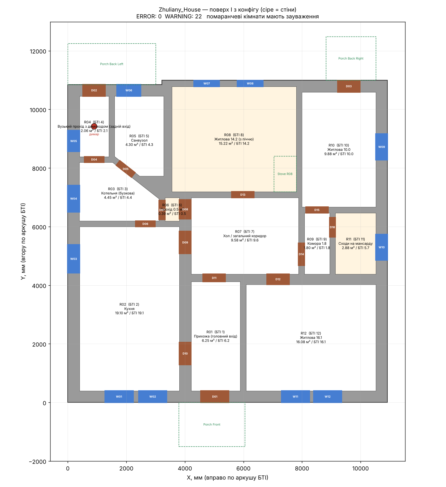

# Zhuliany House — параметрична модель у Fusion 360

Модель будинку на Потоцького 65. Джерело всієї геометрії — **`data/house_config.json`**.
Скрипт Fusion читає його і щоразу будує модель заново, тож розміри змінюються в JSON, а не мишкою.



## Як це влаштовано (головне рішення)

БТІ дає **внутрішні розміри кімнат**, а не координати стін. Тому модель будується «від кімнат»:

1. Зовнішній контур будинку (`footprint`) видавлюється на висоту поверху.
2. З нього вирізаються кімнати. **Стіни — це те, що лишилось між кімнатами.**
3. Кожна кімната прив'язана до сусідів виразами: `"x": "R02.right + bearing_wall_thickness"`.
   Змінив ширину кухні — прихожа, хол і все праворуч зсунулися самі, а стіни лишились потрібної товщини.
4. Двері й вікна прив'язані до сторони кімнати. Товщину стіни скрипт знаходить сам і прорізає її наскрізь.

Так кожна цифра з БТІ вводиться рівно один раз, а товщина стін — окремий параметр.

## Запуск у Fusion 360

1. Склонуй репозиторій на комп'ютер, де стоїть Fusion.
2. Fusion → **Utilities → Add-Ins → Scripts and Add-Ins** (або Shift+S).
3. Вкладка **Scripts → «+»** (Add existing script) → вибери папку `fusion_script/ZhulianyHouse`.
4. Вибери `ZhulianyHouse` → **Run**.
5. Наприкінці з'явиться вікно з підсумком: скільки кімнат, отворів і які є зауваження.
   Повний журнал — у `build_log.txt` в корені репозиторію.

Модель з'являється в компоненті `Zhuliany_House`. **Не редагуй його вручну** — наступний запуск його перебудує.
Свої ескізи й деталі клади в окремі компоненти поза `Zhuliany_House`, їх скрипт не чіпає.

Fusion має бути в режимі **Z up** (Preferences → General → Default modeling orientation).
Якщо стоїть Y up, будинок ляже «на бік» — дані від цього не зміняться.

## Як змінити розмір і перебудувати

1. Відкрий `data/house_config.json`.
2. Знайди кімнату, наприклад `"id": "R08"`, і зміни `"l": {"value": 3590, ...}` на виміряне значення.
3. Постав `"status": "MEASURED"`, якщо міряв рулеткою.
4. Запусти скрипт у Fusion ще раз.

Без Fusion результат можна перевірити так (потрібен Python 3 і `pip install matplotlib`):

```
python tools/preview_plan.py      # оновить docs/plan_preview.png і docs/validation_report.md
python tests/test_model.py        # тести
```

Висоти (`floor_1_height`, `floor_slab_thickness`, `ceiling_thickness`) підключені до геометрії «живими» параметрами —
їх можна покрутити прямо у Fusion (Modify → Change Parameters) для швидкої прикидки. Але при наступному запуску скрипта
вони повернуться до значень з JSON. Решта параметрів у Fusion — довідкові.

## Статуси точності

Кожне число має статус. Скрипт друкує попередження для всього, що не `BTI`, `CALC`, `DERIVED` чи `MEASURED`.

| Статус | Що означає |
|---|---|
| `BTI` | цифра прямо з плану БТІ |
| `CALC` | обчислено з цифр БТІ |
| `DERIVED` | виведено непрямо — з площі, суміжності |
| `APPROX` | оцінено за масштабом креслення, ±0.1–0.3 м |
| `UNKNOWN` | даних немає, стоїть тимчасове значення |
| `MEASURED` | виміряно рулеткою |

## Як додати…

**Кімнату (а з нею і стіни).** Окремих стін у конфігу немає — вони виходять самі. Додай кімнату в `rooms`:

```json
{
  "id": "R13", "bti_no": 13, "bti_area": 9.5, "name": "Нова кімната",
  "x": {"value": "R07.x", "status": "APPROX"},
  "y": {"value": "R07.top + interior_wall_thickness", "status": "CALC"},
  "w": {"value": 2930, "status": "BTI"},
  "l": {"value": 3110, "status": "BTI"}
}
```

Посилатися можна на `Rxx.x`, `.y`, `.w`, `.l`, `.right`, `.top`, `.cx`, `.cy` і на будь-який параметр з `params`.
Скошений кут — `"chamfers": [{"corner": "top_right", "dx": 1000, "dy": 800}]`.

**Двері** — у `openings.items`:

```json
{"id": "D17", "type": "door", "room": "R07", "side": "left", "offset": 500, "width": 800, "status": "MEASURED"}
```

- `side` — `bottom`, `top`, `left`, `right` або `chamfer0` (скошена стіна);
- `offset` — від лівого кінця сторони для `bottom`/`top`, від нижнього кінця для `left`/`right`;
- `width`, `height` можна не писати — візьмуться `door_width_default`, `door_height_default`.

**Вікно** — так само, але `"type": "window"`. Ширина обов'язкова; `height` і `sill` (висота підвіконня) беруться з
`window_height_default` / `window_sill_height_default`, якщо не вказані.

Двері чи вікно ставляться з будь-якого з двох боків стіни — достатньо вказати одну кімнату.

**Ремонтну позначку** — у `repair_marks`:

```json
{"room": "R05", "side": "top", "tag": "MOISTURE", "note": "пліснява над вікном"}
```

Позначка записується атрибутом у тіло кімнати (компонент `Rooms`). Дозволені теги — у `repair_tags`.

## Структура

```
data/house_config.json        ← усі розміри, кімнати, отвори, статуси
data/plans/                   ← плани БТІ і їх розшифровка (bti_notes.md)
data/photos/                  ← фото
src/zhuliany/                 ← ядро без Fusion: читання конфігу, геометрія, перевірки
src/zhuliany/fusion/          ← усе, що викликає Fusion API
fusion_script/ZhulianyHouse/  ← скрипт, який додається у Fusion
tools/preview_plan.py         ← 2D-превʼю і звіт без Fusion
tests/                        ← тести (у т.ч. smoke-тест коду Fusion на підробленому API)
docs/                         ← статус моделі, звіт перевірки, превʼю
```

## Компоненти у Fusion

```
Zhuliany_House
├─ Ground_Floor
│  ├─ Exterior_Walls   (зовнішнє кільце стін)
│  ├─ Interior_Walls   (усе всередині)
│  ├─ Floor_Slab, Ceiling (стеля прихована)
│  ├─ Rooms            (тонкі «плитки» підлоги з назвами й атрибутами)
│  ├─ Doors            (ескіз положень дверей)
│  └─ Windows          (скло у вікнах)
├─ Chimneys / Chimney_Main
├─ Exterior            (контури ґанків)
├─ Technical_Elements  (контур печі в кімнаті 8)
└─ Roof, Heating, Water_Pipes, Boiler — порожні заготовки
```
